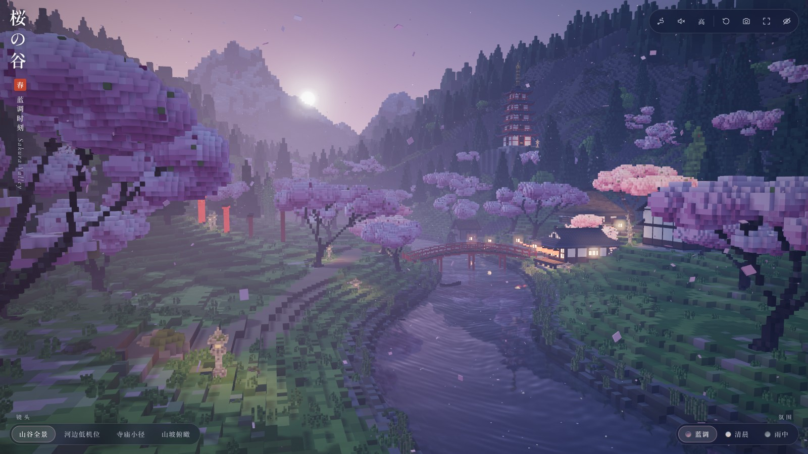
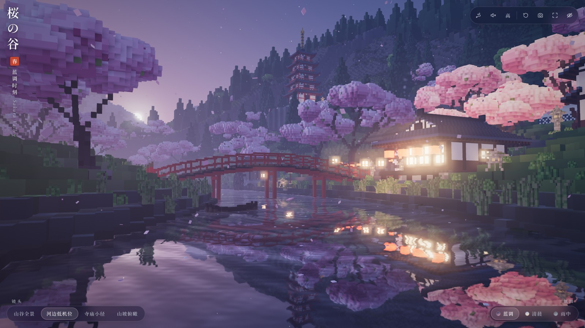
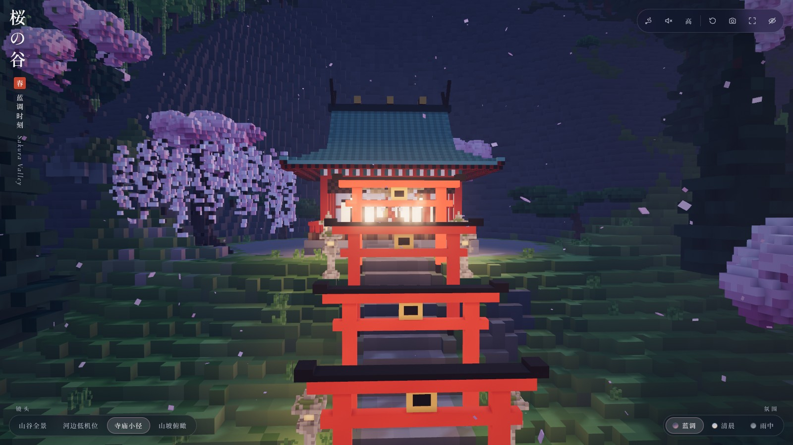
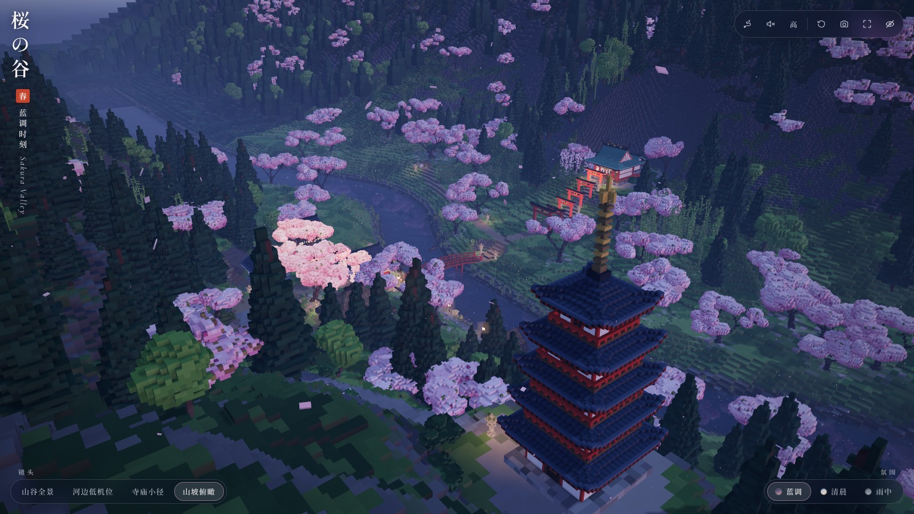
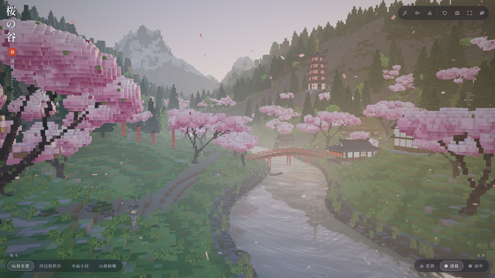
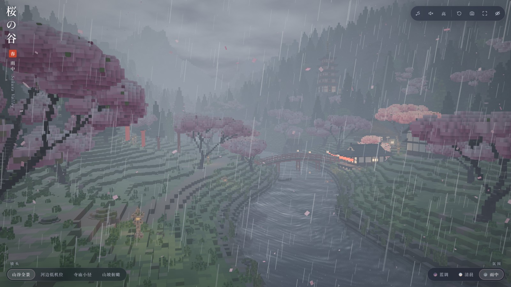

# 桜の谷 · Sakura Valley

一个可以在浏览器里实时游览的日式樱花山谷。整片景观由程序化生成的精细体素构成：蜿蜒的河流与红色太鼓桥、临水茶屋、町家、茅葺民家、土藏与水车小屋、山腰的神社与鸟居石阶、山坡上的五重塔、瀑布、层层山脊和远处的雪山。

| 河边低机位 | 寺庙小径 | 山坡俯瞰 |
| --- | --- | --- |
|  |  |  |

| 清晨 | 雨中 |
| --- | --- |
|  |  |

## 打开方式

直接用浏览器打开 `index.html`（双击或拖进浏览器窗口），不需要构建，也不需要本地服务器。

运行条件：

- 支持 **WebGL 2** 的新版浏览器（Chrome / Edge / Firefox / Safari），并开启硬件加速。
- 需要联网访问 `cdn.jsdelivr.net`，载入固定版本的 Three.js `0.170.0`。标题字体来自 Google Fonts，载入不到时自动换成系统字体，不影响场景。
- 景物全部在本地实时生成（桌面约 2–5 秒），不使用任何图片或模型文件。

## 操作

| 操作 | 桌面 | 触屏 |
| --- | --- | --- |
| 旋转视角 | 左键拖动 | 单指拖动 |
| 前进 / 后退 | 滚轮（朝指针方向） | 双指捏合 |
| 平移 | 右键拖动 | 双指拖动 |
| 聚焦某处 | 双击地面 | 连续轻点两下 |
| 漫步 | `W A S D` / 方向键，`Q` `E` 升降，`Shift` 加速 | — |
| 切换镜头 | 底部「镜头」，或数字键 `1`–`4` | 底部按钮 |
| 隐藏界面 | 右上角按钮，或 `H` | 右上角按钮；右下角小眼睛按钮恢复 |

右上角工具栏依次为：镜头巡游、环境音、画质、重置视角、保存画面、全屏、隐藏界面。

- **四个镜头**：山谷全景、河边低机位、寺庙小径、山坡俯瞰。切换时镜头沿弧线平滑飞行，任何拖动都会接管镜头。
- **三种氛围**：蓝调时刻（默认）、清晨、雨中。切换时天空、太阳与环境光、雾、水面、灯火、地表湿润度、落花、萤火虫、飞鸟、雨丝和环境音一起过渡。
- **镜头巡游**：沿山谷缓慢环行一圈约两分半，拖动画面即退出。
- **环境音**：默认关闭，点击后才播放。河水、瀑布、风、雨、虫鸣、鸟鸣和风铃都由 Web Audio 实时合成，并随镜头位置和氛围变化。
- **保存画面**：弹出当前画面的 PNG 预览，可直接下载；如果所在环境拦截下载，可右键或长按图片另存。
- **画质**：手机默认「轻量」（较低渲染分辨率、较少植被和粒子、较粗的远景）。切换会立即调整分辨率、阴影和粒子数量，几何细节在刷新后生效；帧率不足时还会自动降低渲染分辨率。
- **减少动态效果**：系统开启该偏好时，镜头和氛围改为直接切换，落花、萤火虫、灯火和星光的动画放慢或停止。
- WebGL 2 不可用、CDN 载入失败或显卡上下文丢失时，会显示说明和「重新加载」按钮。

## 实现要点

- 单文件 `index.html`：自写的 HTML、CSS、JavaScript 都在这一个文件里，只通过 import map 引用固定版本的 Three.js。
- 地形是多级分辨率的体素高度场（近景 0.5 m，向外 1 m、2 m，远山 4–8 m），带逐顶点环境光遮蔽；坡面台阶的边缘做了随坡度变化的抖动，避免规整的等高条纹。
- 樱树由分枝骨架体素化而成（主干、分叉、根部、带缝隙的花簇）；建筑、桥、塔、灯笼、鸟居同样由体素网格生成，剔除内部面后合并。重复物体用分区实例化绘制，便于视锥剔除。
- 河面使用实时平面反射，配合程序生成的波纹法线、沿河道的流向、深浅颜色和岸线过渡；雨中叠加雨滴涟漪。
- 灯笼和窗光的暖光烘焙进顶点属性，不需要成批实时光源；蓝调与雨中点亮，清晨熄灭。
- 带高度衰减的雾，并朝太阳方向偏暖，用来表现空气透视；后期为多重采样抗锯齿、克制的泛光、ACES 色调映射、轻微暗角和防色带抖动。

## 验收说明

截图均来自无头 Chromium（SwiftShader 软件渲染）实际运行本页面，检查了四个镜头、三种氛围、桌面 1280×720 / 1600×900、手机竖屏 390×844 与横屏 844×390 的布局，以及界面按钮、键盘操作、减少动态效果、WebGL 不可用和 CDN 失败时的提示，控制台无报错。

没有条件验证的部分：真实显卡上的帧率、真机手机上的触控手感与发热、Safari 与 Firefox 的表现，以及环境音的实际听感（只确认了音频能开启和关闭）。
